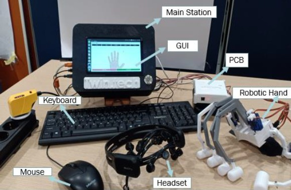
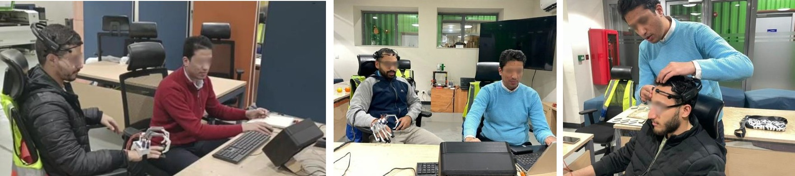
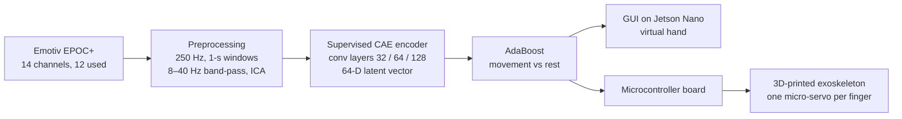
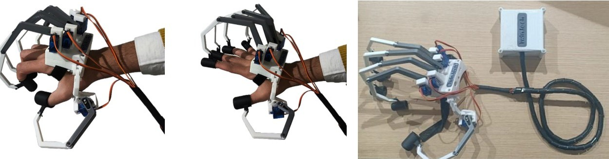

# Real-time EEG BCI driving a 3D-printed hand exoskeleton

M.Sc. project of Fady M. Omar (Fady Mostafa) at the Military Technical College, Cairo, published at IEEE NILES 2025:

> Fady M. Omar, Amr M. Omar, Khaled Eyada, Mohamed Rabie, Ahmed M. Azab, Mohamed A. Kamel.
> *A Real-Time BCI for Stroke Hand Rehabilitation Using Latent EEG Features from Healthy Subjects.*
> Proceedings of the 7th Novel Intelligent and Leading Emerging Sciences Conference (NILES 2025), IEEE.
> [IEEE Xplore](https://doi.org/10.1109/NILES68063.2025.11232154) · [arXiv:2510.15890](https://arxiv.org/abs/2510.15890)

## The system

<p align="center">
  
</p>

*The complete system: the main station (NVIDIA Jetson Nano with a touchscreen GUI), the Emotiv EPOC+ headset, the
control board (PCB) and the robotic hand exoskeleton.*

## Online tests with volunteers

<p align="center">
  
</p>

*Online sessions with healthy volunteers. Left and middle: the volunteer wears the headset and the exoskeleton while the
operator runs the station. Right: fitting the Emotiv EPOC+ headset before a session. Faces are blurred.*

## In short
- **Goal:** a low-cost, portable brain–computer interface that turns imagined hand movement into real movement of a
  robotic hand exoskeleton, as a step toward home-based hand rehabilitation after stroke.
- **Hardware:** a 14-channel Emotiv EPOC+ consumer headset; an NVIDIA Jetson Nano (4 GB) that runs the decoder and the
  GUI; a microcontroller board that drives one micro-servo per finger on a 3D-printed exoskeleton.
- **Decoder:** trained only on a public dataset of other healthy people's executed grasp movements (WAY-EEG-GAL), using
  the 12 electrodes that the dataset shares with the Emotiv headset. A supervised convolutional autoencoder compresses
  each 1-s EEG window into 64 features, and an AdaBoost classifier decides between *movement* and *rest*.
- **Testing:** offline on the public dataset, then online with five healthy volunteers who imagined opening and closing
  the hand while the exoskeleton responded.

## How the system works



**Training data.** WAY-EEG-GAL ([Luciw, Jarocka & Edin, 2014](https://doi.org/10.1038/sdata.2014.47)): EEG from 12
healthy people performing grasp-and-lift. The 1,495 trials labelled *FirstDigitTouch* formed the movement class, and rest
samples were taken from the intervals between trials. Only the 12 electrodes present on both the dataset cap and the
Emotiv headset were kept: F7, F3, FC5, T7, P7, O1, O2, P8, T8, FC6, F4, F8.

**Preprocessing.** Resampling to 250 Hz, 1-s windows (12 channels × 250 samples), an 8–40 Hz band-pass filter, and ICA
to remove eye, muscle and cardiac components.

**Decoder (SupCAE-Boost).** The encoder has three convolutional layers (32, 64 and 128 filters), each with batch
normalisation and leaky-ReLU, and outputs a 64-dimensional latent vector. It was trained on two objectives at once:
reconstructing the EEG window, and separating movement from rest through a small auxiliary classifier head that is
removed after training. AdaBoost then classifies the latent vector. For deployment, the encoder was exported in reduced
precision (FP16/INT8) to run on the Jetson Nano.

**Exoskeleton.** A PETG frame for stiffness, TPU at every skin contact, and a dorsal mount with soft straps that leave
the palm free. Each finger is driven independently through a light linkage by an FS90MG metal-gear micro-servo (stall
torque 2.2 kg·cm). The nominal range is 120° per finger, and the total mass is 450 g including cables. The GUI shows a
virtual hand that opens and closes with the decoded state, and the system also has a passive-assistance mode.

<p align="center">
  
</p>

*The exoskeleton in flexion and extension (left), and the final device with its control box (right).*

## Results as published

**Offline** (WAY-EEG-GAL, 12 shared channels, one fixed train/validation/test split; Fig. 7 of the paper)

| Classifier on the CAE features | Train | Validation | Test |
|---|---|---|---|
| AdaBoost (deployed) | 99.97% | 89.57% | 89.30% (F1 0.89) |

Fourteen classifiers were trained on the same latent features. Eleven of them reached 88.5–89.3% on the test set, and
AdaBoost and LightGBM tied for the highest value, so once the CAE features were fixed the choice of classifier
mattered little.

**Online** (five healthy volunteers: 3 men and 2 women aged 24–32; Emotiv EPOC+; 15 motor-imagery trials each of hand
opening and closing; Fig. 9 of the paper)

| Volunteer | 1 | 2 | 3 | 4 | 5 |
|---|---|---|---|---|---|
| Accuracy | 80% | 60% | 80% | 86% | 73% |

The paper reports this as a range of 60–86%. Across all 75 trials the mean is 76% (our calculation from Fig. 9).

## How to read these numbers
- **The offline and online numbers measure different things.** The offline accuracy is for recorded *executed* grasps
  in the public dataset. The online accuracy is for *imagined* hand movement by new people wearing a different
  headset. The 89.3% therefore does not describe online use; the 60–86% does.
- **Fifteen trials per person is a small number.** Each trial changes the accuracy by 6.7 points (60% = 9 of 15,
  86% ≈ 13 of 15). For a two-class decision at a 50% chance level, a coin flip scores 9 or more out of 15 about 30% of the
  time. Volunteers 1, 3 and 4 were above chance (one-sided binomial test, p < 0.05; our calculation), while volunteers
  2 and 5 (60% and 73%) could not be separated from chance.
- **Everyone tested was healthy.** The system has not been tested with stroke patients, whose movement-related EEG can
  differ from that of healthy people.
- **Not measured in the paper:** end-to-end latency, usability and comfort, all of which the paper lists as future work.
  The paper's limitations also mention a short calibration with each volunteer.

This was a feasibility study: it showed that the complete chain, from a consumer headset to the moving exoskeleton,
works in real time on low-cost hardware. It was not a clinical evaluation.

## What came next
This project rested on one idea: that a decoder built from *other people's executed movements* can work for a *new
person's imagined movement*. The follow-up study tests that idea under controlled conditions, with all code and
per-person results public:
**[movement-library-calibration](https://github.com/fady-mostafa-omar/movement-library-calibration)**. It uses 15 people
from a public dataset (Ofner et al., 2017), leave-one-subject-out testing and dated analysis protocols, and measures how
much of a new user's calibration such a library replaces (manuscript under review).

## Citation
```bibtex
@inproceedings{omar2025realtime,
  title         = {A Real-Time {BCI} for Stroke Hand Rehabilitation Using Latent {EEG} Features from Healthy Subjects},
  author        = {Omar, Fady M. and Omar, Amr M. and Eyada, Khaled and Rabie, Mohamed and Azab, Ahmed M. and Kamel, Mohamed A.},
  booktitle     = {Proceedings of the 7th Novel Intelligent and Leading Emerging Sciences Conference (NILES 2025)},
  publisher     = {IEEE},
  year          = {2025},
  doi           = {10.1109/NILES68063.2025.11232154},
  eprint        = {2510.15890},
  archivePrefix = {arXiv}
}
```

## Acknowledgements
The work was supported by the Academy of Scientific Research and Technology (ASRT), Egypt, and by the Technological
Incubator for Prostheses and Orthoses (TIPO) at the Military Technical College, Cairo. Author affiliations are given
in the paper.

## License
The text of this repository is licensed under [CC BY 4.0](LICENSE). The photos are © the authors; please ask before
reusing them. The paper itself is not included here; it can be read on IEEE Xplore or arXiv.
